  

  
  
  

> *Oh, hello darling. Lovely night for it, isn't it?*

Hi, I'm **PιɳC**. I'm currently a Bob Velseb fictkin: the friendly grill cook from across the street, a little too interested in what's for dinner. I keep the grill hot, the knives sharp and the candy jar full. Mostly with candy taken from past victims.

- 🍖 Works the grill at Boys 'n Grill (ask about the special. actually, maybe don't)
- 🍬 Will stop mid-chase for candy. Any candy. Yours especially
- 🏚️ Lives across the street and is definitely not watching your house
- 🎃 Comes out every Halloween or every other day, without fail

  

  
  
  

